<a href="https://remipelloux.github.io/">
  
</a>

 

  
  
  
  
  
  

<h3 align="center">I build AI systems that people actually run.</h3>

<em>LLM agents and MCP&nbsp; ·&nbsp; tools for coding agents&nbsp; ·&nbsp; local-first apps&nbsp; ·&nbsp; Rust systems&nbsp; ·&nbsp; security research</em>

  
  
  
  
  
  
  
  
  
  
  

  <a href="#concerto">Concerto</a> &nbsp;·&nbsp;
  <a href="#agent-tooling">Agent tooling</a> &nbsp;·&nbsp;
  <a href="#modelly">Modelly</a> &nbsp;·&nbsp;
  <a href="#open-source">Open source</a> &nbsp;·&nbsp;
  <a href="#security">Security</a> &nbsp;·&nbsp;
  <a href="#at-openpro">At OpenPro</a> &nbsp;·&nbsp;
  <a href="#activity">Activity</a>

I'm **Rémi Pelloux**, an AI engineer and the **CTO and co-founder of [OpenPro](https://openpro.ai)**, in Nice, France. I have ten years of full-stack, security and cloud work behind me. Today I design **LLM systems and run them in production**: tool-calling agents, MCP servers, retrieval, realtime voice, and routing across providers with fallback, caching and cost control. In my spare time I build **tools for AI coding agents**, **local-first apps**, **Rust systems tools** and **security research**, all in public. Before OpenPro I did security, R&D and full-stack work for clients including Dassault Aviation, DGA, Thales and Decathlon.

**[Portfolio →](https://remipelloux.github.io/)** &nbsp;·&nbsp; [CV in English and French](https://remipelloux.github.io/cv/) &nbsp;·&nbsp; [Security reports](https://remipelloux.github.io/security/) &nbsp;·&nbsp; [Lab](https://remipelloux.github.io/lab/) &nbsp;·&nbsp; [Learn to code with AI agents](https://remipelloux.github.io/iadevlearn/)

 

## 🎼 Latest: Concerto — one request, a team of coding agents

<a href="https://github.com/RemiPelloux/Concerto">
  
</a>

**Hand it the whole feature. Get back code that was planned, built by the right model, tested, reviewed by a second model and merged.** A single coding agent working through a big request is slow and expensive, and it grades its own work. Concerto runs the job like a team:

- **The right model for every story.** Concerto splits the request into user stories and scores each one on ten factors (its reach in the import graph, untested code, risk, churn and more). Risky work goes to Opus or GPT-6.1 Sol, and small work goes to Haiku or a free local model. You can see why each story got its score and change it before the build starts.
- **Nothing unchecked reaches your branch.** Each story is built in its own git worktree. It then has to pass your tests and type check, a mutation probe and a secret scan. Risky stories are also reviewed by a model from another vendor. The merge is three-way, so your own edits are kept.
- **It uses the agents you already pay for.** Claude Code, Codex, Gemini CLI, Cursor, OpenCode, Goose, Aider, pi, and local models through Ollama or LM Studio. Concerto never holds an API key.
- **Each run reports its cost.** The expensive model plans and wakes up only at checkpoints. The report compares the run's cost with what that model alone would have cost.

[**Install →**](https://github.com/RemiPelloux/Concerto#install) &nbsp;·&nbsp; [Docs](https://remipelloux.github.io/Concerto/) &nbsp;·&nbsp;  &nbsp;·&nbsp; `TypeScript` `TUI` `MCP` · Homebrew, Scoop, apt, Nix · MIT

 

## 🤖 Tools for AI coding agents

  <a href="https://github.com/RemiPelloux/pelloux-guidelines"></a>
  <a href="https://github.com/RemiPelloux/kill-my-idea"></a>

<table>
<tr>
<td width="50%" valign="top">

### [Pelloux Guidelines](https://github.com/RemiPelloux/pelloux-guidelines) &nbsp;

**Coding discipline for AI agents.** Ten rules and a few hard numbers keep agent-written code small enough to review: files of 400 lines at most, functions of 25 lines, 3 parameters. A zero-dependency audit checks them in the agent loop, before every commit and in CI. A ratchet holds legacy code, which can shrink but never grow.

- Nine language profiles. Works with Claude Code, Codex, Cursor, Copilot, Windsurf and Gemini
- Used in more than thirty repositories. One-line installer, Claude Code plugin and skills

`Python` `pre-commit` `CI` · MIT

</td>
<td width="50%" valign="top">

### [kill-my-idea](https://github.com/RemiPelloux/kill-my-idea) &nbsp;

**A Claude Code plugin that tries to kill your startup idea before you build it.** It looks for free alternatives, competitors, people who already failed and numbers that don't add up. Then it gives a score out of 100, a GO / PIVOT / NO-GO verdict and a 7-day test, with a source for every number.

- Market size, CAC, LTV and break-even, per country. A roast mode, and a fact-checker for viral "$10k/month" posts
- Listed in [Awesome AI Plugins](https://github.com/hashgraph-online/awesome-ai-plugins). [Live reports](https://remipelloux.github.io/kill-my-idea/)

`Claude Code plugin` `skills` · MIT

</td>
</tr>
<tr>
<td width="50%" valign="top">

### [OpenTerm](https://github.com/RemiPelloux/openterm) &nbsp;

**The terminal that speaks to your model.** A native macOS terminal built on Ghostty, in Rust. It shrinks noisy command output before your model reads it, and its 39 `ai-*` wrappers send tests, linters, diffs and logs through RTK. It also keeps every byte as encrypted evidence (XChaCha20-Poly1305), and it works with any LLM, including the Claude or ChatGPT plan you already pay for.

`Rust` `Swift` `Ghostty` · macOS · Apache-2.0 · alpha

</td>
<td width="50%" valign="top">

### [SmartTest](https://github.com/RemiPelloux/SmarttyTest) &nbsp;

**Runs only the tests a change can affect.** SmartTest builds a symbol-level dependency graph of the repository, finds what a change reaches and runs those tests through your own runner: Jest, Vitest, `node --test`, Playwright, Cypress or Angular. Every skipped test comes with a reason, and `audit --mutate` checks that the selection catches real breaks. It runs in the commit hooks at OpenPro and LeadsIt.

`TypeScript` · Python and PHP in preview · Apache-2.0 · [docs](https://remipelloux.github.io/SmarttyTest/)

</td>
</tr>
</table>

<a href="https://github.com/RemiPelloux/OpenVision">
  
</a>

### [OpenVision](https://github.com/RemiPelloux/OpenVision) — an AI coding workspace where you choose the models

A project explorer, an editor, terminals, Git worktrees, agents and Tab autocomplete in one desktop app. Point it at any OpenAI-compatible API or a server on `127.0.0.1`, and it discovers the available models. There is no account and no login. Agents run tools only after you approve them, and they read MCP servers, project rules and skills from `.openvision/`. The portable Windows build runs without Node or npm.

[**Download →**](https://github.com/RemiPelloux/OpenVision/releases) &nbsp;·&nbsp; `Electron` `TypeScript` `MCP` · development preview, Windows x64

 

## 🧬 Modelly — agent-based modeling for Python

<a href="https://remipelloux.github.io/Modelly/">
  
</a>

**A framework for agent-based modeling (ABM) in Python, fast by construction.** Scenarios are typed and every run is seeded, so a shared config gives back the same numbers. Agents are backed by numpy and live on grids, networks or continuous space, with discrete-event time, pandas data collection and a browser view to watch a run live. A codemod helps you move models over from Mesa, and [modelly-hub](https://github.com/RemiPelloux/modelly-hub) indexes published models with DOIs and checksums.

[**Read the docs →**](https://remipelloux.github.io/Modelly/) &nbsp;·&nbsp; [Source](https://github.com/RemiPelloux/Modelly) &nbsp;·&nbsp;  &nbsp;·&nbsp; `Python` `numpy` `pandas` `C` · Apache-2.0

 

## 🧪 Open source

  <a href="https://github.com/RemiPelloux/OpenPlod"></a>
  <a href="https://github.com/RemiPelloux/OpenNative"></a>

<table>
<tr>
<td width="50%" valign="top">

### [OpenPlod](https://github.com/RemiPelloux/OpenPlod) &nbsp;

**A local-first vault for your Plaud Note Pro recordings.** OpenPlod imports audio directly over Bluetooth, keeps the original files, and turns them into transcripts, Markdown documents and AI chats that cite their sources.

- Transcript Studio: speaker editing, version diffs, chapters and subtitles
- Transcription with Mistral/Voxtral, OpenAI or AssemblyAI, plus local Ollama for text
- REST API and a **read-only MCP server**, so your agents can query your recordings

`Tauri` `Rust` `TypeScript` · macOS, experimental Android · MIT

</td>
<td width="50%" valign="top">

### [OpenNative](https://github.com/RemiPelloux/OpenNative) &nbsp;

**Windows games on Android gaming handhelds.** OpenNative combines Wine/Proton, DXVK, VKD3D, Mesa, Box64 and FEX in an interface built for controllers.

- Warm, shared Wine prefixes that launch quickly, with per-game profiles
- Shader caches tracked per game, safe cache invalidation, and a performance view on a second screen
- APK updates checked against their signature and checksum. FPS gains are claimed only after measurement

`Kotlin` `C++` `Android ARM64` · validated on AYN Thor · GPL-3.0

</td>
</tr>
</table>

<a href="https://github.com/RemiPelloux/Containust">
  
</a>

### [Containust](https://github.com/RemiPelloux/Containust) &nbsp;

**A container runtime written in Rust, with no background daemon.** Each `ctst` command talks to the backend directly and writes file state. You describe stacks in a small declarative language (`.ctst`: `COMPONENT`, `CONNECT`, `EXPOSE`). Images are pulled by pinned digest, and `--offline` blocks network access before anything connects, so it works on air-gapped machines. On Linux it uses namespaces and cgroups v2 directly. On macOS and Windows it runs through QEMU. It also ships a Rust SDK for the parser, the graph and the runtime.

`Rust` `Linux namespaces` `cgroups v2` `OCI` · source-available, commercial license

<strong>More public work</strong>

 

| Project | What it is | Stack |
| --- | --- | --- |
| [**unslop**](https://github.com/RemiPelloux/unslop) | Rules for interfaces and copy that don't look machine-made, with checks: no shadows, no gradients, no emoji, 350 banned words. An Agent Skill for Claude, Codex, Cursor, Copilot and Gemini | `Python` `Markdown` |
| [**gitverse**](https://github.com/RemiPelloux/gitverse) | Learn Git by using it: a simulated terminal, a live commit graph and lessons that check your repository, in English and French. [Live](https://remipelloux.github.io/gitverse/) | `TypeScript` `Next.js` |
| [**agent-mangaka-forge**](https://github.com/RemiPelloux/agent-mangaka-forge) | AI manga-page skill pack with persistent character memory for consistent characters | `Python` |
| [**DrosoSim Next**](https://github.com/RemiPelloux/DrosoSimBetter) | Real-time decision simulator for growers fighting the fruit fly *Drosophila suzukii* | `TypeScript` |
| [**OpenSw**](https://github.com/RemiPelloux/OpenSw) | Android ARM64 Switch emulator with Vulkan rendering, per-game profiles and AYN Thor tuning | `C++` `Vulkan` |
| [**OpenAgents**](https://github.com/RemiPelloux/OpenAgents) | Self-hosted, multi-provider AI agents with memory and MCP, forked from [Hermes Agent](https://github.com/NousResearch/Hermes-agent) | `Python` `MCP` |
| [**templateCardGame**](https://github.com/RemiPelloux/templateCardGame) | Template for server-authoritative multiplayer card games: pure rules engine, rooms with bots, React table | `TypeScript` |
| [**LumaSync**](https://github.com/RemiPelloux/lumasync) | Local Philips Hue ambilight driven by fast screen capture | `Rust` `Tauri` `React` |
| [**OpenPro Connector SDK**](https://github.com/RemiPelloux/openpro-connector-sdk) | Sync ATS jobs into OpenPro through PHP, HTTP or MCP | `PHP` |
| [**OpenWhistle SDKs**](https://github.com/RemiPelloux/openwhistle-sdks) | OpenWhistle API clients for five languages | `JS` `Python` `PHP` `Rust` `Go` |
| [**delonghi-coffee-api**](https://github.com/RemiPelloux/delonghi-coffee-api) | Local REST API for De'Longhi machines, built on the reverse-engineered ECAM protocol | `Python` `FastAPI` |

Everything else is in the [archive](https://remipelloux.github.io/work/) and the [lab](https://remipelloux.github.io/lab/).

 

## 🔐 Security research

<a href="https://github.com/RemiPelloux/HackoogleMini">
  
</a>

### [HackoogleMini](https://github.com/RemiPelloux/HackoogleMini) &nbsp;

**Software-only research to get a shell on a first-generation Google Home Mini, then replace Google Assistant with a local LLM that can call MCP servers.** No hardware modifications. The research covers the device's pre-release Chrome 92 (CVE-2021-30563), Cast registry interception, the Magellan SQLite bugs, the BLE setup protocol, firmware acquisition and YAFFS2 kernel work.

`Python` `reverse engineering` `Cast` `BLE` `embedded Linux`

| Reference | Project | What happened |
| --- | --- | --- |
| [**CVE-2026-45753**](https://github.com/advisories/GHSA-hhg7-c65m-h7ff) | Symfony HtmlSanitizer | The URL sanitizer skipped `action`, `formaction`, `poster` and `cite`, so a `javascript:` URI could get through and cause XSS. I reported it, and the Symfony team fixed it in 6.4.40, 7.4.12 and 8.0.12. [Write-up](https://remipelloux.github.io/security/) |
| **2026, in triage** | Tailscale | One finding was new to Tailscale's security team and is being fixed, with credit. Details stay private until the fix ships |
| [**php-upload-rce**](https://github.com/RemiPelloux/php-upload-rce) | PHP | An independent source-level analysis of the `session.upload_progress` use-after-free (CVE-2026-109618 and CVE-2026-109619, CVSS 9.2, fixed on 21 October 2026). Includes a heap layout study, a lab, an exposure scanner and a one-line fix. I studied this bug; I didn't find it |
| [**BurpHunterTK**](https://github.com/RemiPelloux/BurpHunterTK) | Burp Suite | An extension that uses LLMs to flag high and critical vulnerabilities during bug bounty work |

  <a href="https://github.com/RemiPelloux/android-hid-kb"></a>
  <a href="https://github.com/RemiPelloux/GalaxyCrash"></a>

<table>
<tr>
<td width="50%" valign="top">

### [android-hid-kb](https://github.com/RemiPelloux/android-hid-kb) &nbsp;

**Turn a rooted Android phone into a USB hardware keyboard.** Using the Linux `configfs` gadget stack (`f_hid`) and only `mksh` shell builtins, the phone shows up on any PC as a plain keyboard and types out a text file. The PC needs no app and no driver.

`Android` `configfs` `USB HID` `shell`

</td>
<td width="50%" valign="top">

### [GalaxyCrash](https://github.com/RemiPelloux/GalaxyCrash) &nbsp;

**Temporary root for Samsung Galaxy devices, a stability fork of DirtyFrag (CVE-2026-43284).** Root is granted in memory, for research on your own device. A reboot undoes it completely, because nothing is written to the system partition.

`Java` `Android` · reboot to undo

</td>
</tr>
</table>

 

## 🎴 Live apps

| App | What it is |
| --- | --- |
| [**deal-club.fun**](https://deal-club.fun) | An installable French real-estate card game (PWA). You buy, trade and auction properties against AI opponents that run on your device, so it plays offline. Includes 58 original hand-drawn SVG illustrations |
| [**LeadsIt**](https://leadsit.eu) | An automated B2B lead search platform, with an in-app agent that has 18 tools and asks for confirmation before every write, plus a hosted MCP server |
| [**Gitverse**](https://remipelloux.github.io/gitverse/) | A gamified Git course that runs entirely in the browser, in English and French |
| [**IA Dev Learn**](https://remipelloux.github.io/iadevlearn/) | A free course for learning to code with AI agents by doing it. You prompt Claude Code, Codex, Gemini CLI and Antigravity in a simulated terminal, write rules and skills, and run a team of agents in parallel with Orca. No account or API key, in English and French |

 

## 🏗️ At OpenPro


[OpenPro](https://openpro.ai) is a French professional network for **people, jobs and companies**. It has video CVs, AI matching, real-time messaging and Mia, our AI assistant, on web, iOS and Android. I co-founded it and have been CTO since February 2023. The code is private, but this is the engineering I'm responsible for:

- **Mia, the assistant.** A streaming tool-calling agent with **87 tools**, and a live voice mode on OpenAI Realtime, with Gemini Live and Grok as fallbacks.
- **A hosted MCP server at `mcp.openpro.ai`.** It uses Streamable HTTP and OAuth 2.1 with PKCE, filters tools by role and scope, and includes an MCP App for editing job drafts.
- **One LLM layer over 10 providers.** A Claude → Mistral → OpenAI fallback chain, prompt caching, a cost log for every call and a monthly budget breaker.
- **A multi-agent offer writer.** A triage agent hands off to four specialists and their output is checked against a schema. It runs on the OpenAI Agents SDK, with Claude plugged in as a custom model provider.
- **The platform.** A Laravel core, TypeScript and React on the web, and Flutter apps for iOS and Android. It runs on PostgreSQL and Redis on AWS, in Docker, released through CI/CD and hosted in the EU under GDPR. ATS partners connect through a [public SDK](https://github.com/RemiPelloux/openpro-connector-sdk) over HTTP and MCP.

<strong>How I build with agents</strong>

 

- **Rules, not hope.** The [Pelloux Guidelines](https://github.com/RemiPelloux/pelloux-guidelines) run in 32 repositories, checked in the agent loop, at pre-commit and in CI.
- **Several agents a day.** Claude Code, Codex, Cursor, Gemini CLI and Copilot, with parallel agents in git worktrees, coordinated by [Concerto](https://github.com/RemiPelloux/Concerto).
- **My own tooling.** 25 Claude Code skills (task graphs, decision and quality gates), 306 Cursor rules and 23 `AGENTS.md` files.
- **13 MCP servers, more than 260 tools:** OpenPro 87, OpenCRM 41, OpenPlod 30, OpenTicket 20, Obsidian 15, and more.
- **Measure before claiming.** Latency, recovery and acceptance gates are written down. Forks and integrations credit the projects they build on.

 

## 📈 Activity

<a href="https://github.com/RemiPelloux?tab=overview">
  <picture>
    <source media="(max-width: 600px)" srcset="./assets/contributions-mobile.svg" />
    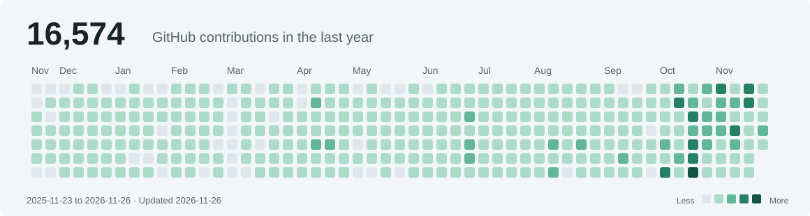
  </picture>
</a>

Contribution calendar, refreshed daily by a GitHub Action

All animations are self-contained SVGs with no scripts or network requests, and they stop when your system asks for reduced motion.

