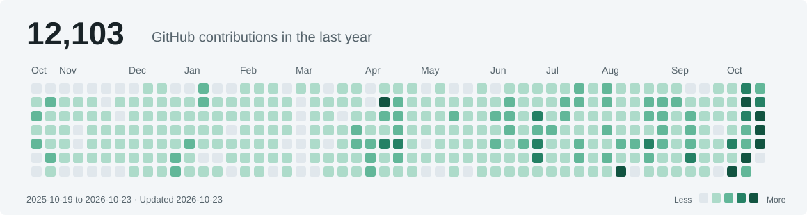

 

  
  
  
  

  <a href="#openvision">OpenVision</a> &nbsp;·&nbsp;
  <a href="#modelly">Modelly</a> &nbsp;·&nbsp;
  <a href="#open-source">Open source</a> &nbsp;·&nbsp;
  <a href="#live">Live apps</a> &nbsp;·&nbsp;
  <a href="#at-openpro">At OpenPro</a> &nbsp;·&nbsp;
  <a href="#activity">Activity</a>

I'm **Rémi Pelloux**, a software engineer and **CTO at [OpenPro](https://openpro.ai)** in France. I build software that people actually run: **AI developer tools that work with your own models**, a **Python framework for agent-based modeling**, **local-first native apps that keep data on your machine**, **systems tools written in Rust without hidden daemons**, and **Android research tooling**. During the day I lead engineering at OpenPro. The rest of the time I ship in public.

 

## 👁️ Latest: OpenVision — an AI coding workspace

**An AI coding workspace where you choose the models.** OpenVision brings together a project explorer, editor, terminals, Git and worktrees, AI agents and Tab autocomplete in one desktop app. Point it at any OpenAI-compatible API or a server on `127.0.0.1`, and it discovers the available models. You can pick a separate model just for autocomplete.

- **No account and no login.** Built-in analytics and crash uploads are disabled at build time.
- **Agents with approved tools.** Agents read files, propose edits and run tools only after you approve them. They also get MCP, project rules, skills and plans from `.openvision/`.
- **A portable Windows app.** Download the zip, extract it, and double-click to run. You don't need to set up Node or npm.
- **Honest progress.** The roadmap tracks acceptance stories, and only the ones that pass are marked verified.

[**Download the latest build →**](https://github.com/RemiPelloux/OpenVision/releases) &nbsp;·&nbsp; [Read the docs](https://github.com/RemiPelloux/OpenVision/tree/main/docs) &nbsp;·&nbsp; `Electron` `TypeScript` `MCP` · development preview, tested on Windows x64

 

## 🧬 Modelly — agent-based modeling for Python

**A framework for agent-based modeling (ABM) in Python — fast by construction.** Modelly lets you describe a population of agents and the world they live in, run the simulation, and collect the results as data you can analyze. It is built for reproducibility: scenarios are typed, and every run is seeded so you get the same numbers back.

- **Typed scenarios and seeded, reproducible runs** — share a config, get identical results.
- **numpy-backed agents** on grids, networks and continuous space, with a discrete-event scheduler.
- **pandas data collection** out of the box, plus a browser visualization for watching a run live.
- **A codemod path from [Mesa](https://github.com/projectmesa/mesa)**, so existing models can move over.

[**Read the docs →**](https://remipelloux.github.io/Modelly/) &nbsp;·&nbsp; [Source on GitHub](https://github.com/RemiPelloux/Modelly) &nbsp;·&nbsp; `Python` `numpy` `pandas` · simulation · reproducible research

 

## 🧪 Open source

  
  

<table>
<tr>
<td width="50%" valign="top">

### [OpenPlod](https://github.com/RemiPelloux/OpenPlod) &nbsp;

**A local-first vault for your Plaud Note Pro recordings.** OpenPlod imports audio directly over Bluetooth, keeps the original files, and turns them into transcripts, Markdown documents and AI chats that cite their sources.

- Transcript Studio: speaker editing, version diffs, chapters and subtitles
- Transcription with Mistral/Voxtral, OpenAI or AssemblyAI, plus local Ollama for text
- REST API and a **read-only MCP server**, so your agents can query your recordings

`Tauri` `Rust` `TypeScript` · macOS / Linux / Windows · experimental

</td>
<td width="50%" valign="top">

### [OpenNative](https://github.com/RemiPelloux/OpenNative) &nbsp;

**Windows games on Android gaming handhelds.** OpenNative combines Wine/Proton, DXVK, VKD3D, Mesa, Box64 and FEX in an interface built for controllers.

- Warm, shared Wine prefixes that launch quickly, with per-game profiles
- Shader caches tracked per game, safe cache invalidation, and a performance view on a second screen
- APK updates checked against their signature and checksum. FPS gains are claimed only after measurement

`Kotlin` `C++` `Android ARM64` · validated on AYN Thor · GPL-3.0

</td>
</tr>
</table>

### [Containust](https://github.com/RemiPelloux/Containust) &nbsp;

**A container runtime written in Rust, with no background daemon.** Each `ctst` command talks to the backend directly and writes file state. You describe stacks in a small declarative language (`.ctst`: `COMPONENT`, `CONNECT`, `EXPOSE`). Images are pulled by pinned digest, and `--offline` blocks network access before anything connects, so it works on air-gapped machines. On Linux it uses namespaces and cgroups v2 directly. On macOS and Windows it runs through QEMU. It also ships a Rust SDK for the parser, the graph and the runtime.

`Rust` `Linux namespaces` `cgroups v2` `OCI` · source-available, commercial license

 

### 📱 Android research tooling

  
  

<table>
<tr>
<td width="50%" valign="top">

### [android-hid-kb](https://github.com/RemiPelloux/android-hid-kb) &nbsp;

**Turn a rooted Android phone into a USB hardware keyboard.** Using the Linux `configfs` gadget stack (`f_hid`) and nothing but `mksh` shell builtins, the phone presents itself to any PC as a plain keyboard and types out a text file — no app, no driver on the host side.

`Android` `configfs` `USB HID` `shell` · works on a console or a desktop

</td>
<td width="50%" valign="top">

### [GalaxyCrash](https://github.com/RemiPelloux/GalaxyCrash) &nbsp;

**Ephemeral root for Samsung Galaxy devices — a stability-focused fork of DirtyFrag.** Root is granted in memory for research on your own device, and a reboot undoes it completely: nothing is written to the system partition.

`Java` `Android` `security research` · reboot to undo

</td>
</tr>
</table>

<strong>More public work</strong>

 

| Project | What it is | Stack |
| --- | --- | --- |
| [**OpenSw**](https://github.com/RemiPelloux/OpenSw) | Android ARM64 Switch emulator with Vulkan rendering, per-game profiles and AYN Thor tuning | `C++` `Vulkan` |
| [**agent-mangaka-forge**](https://github.com/RemiPelloux/agent-mangaka-forge) | AI manga-page skill pack with persistent character memory for consistent characters | `Python` |
| [**OpenAgents**](https://github.com/RemiPelloux/OpenAgents) | Self-hosted, multi-provider AI agents with memory and MCP, forked from [Hermes Agent](https://github.com/NousResearch/Hermes-agent) | `Python` `MCP` |
| [**steamio**](https://github.com/RemiPelloux/steamio) | Steam-style desktop game catalog, library and download manager with SQLite FTS5 search | `Tauri` `React` `Rust` |
| [**LumaSync**](https://github.com/RemiPelloux/lumasync) | Local Philips Hue ambilight driven by fast screen capture | `Rust` `Tauri` `React` |
| [**OpenPro Connector SDK**](https://github.com/RemiPelloux/openpro-connector-sdk) | Sync ATS jobs into OpenPro through PHP, HTTP or MCP | `PHP` |
| [**OpenWhistle SDKs**](https://github.com/RemiPelloux/openwhistle-sdks) | OpenWhistle API clients for five languages | `JS` `Python` `PHP` `Rust` `Go` |
| [**delonghi-coffee-api**](https://github.com/RemiPelloux/delonghi-coffee-api) | Local REST API for De'Longhi machines, built on the reverse-engineered ECAM protocol | `Python` `FastAPI` |

 

## 🎴 Live apps

### [deal-club.fun](https://deal-club.fun) — a real-estate card game, in your browser

**Build a property empire, one deal at a time.** deal-club.fun is an installable **French real-estate card game** (PWA): you buy, trade and auction properties against **AI opponents that run entirely on your device**, so a game works offline once the page is loaded. It ships with classic card rules and **58 original hand-drawn SVG illustrations**.

`TypeScript` `PWA` `offline-first` · [**Play it now →**](https://deal-club.fun)

 

## 🏗️ At OpenPro

[OpenPro](https://openpro.ai) is a French professional network for **people, jobs and companies**. It offers video CVs, AI matching, real-time messaging and Mia, our AI assistant, on web, iOS and Android. The code is private, but this is the engineering I'm responsible for as CTO:

- **Product platform.** A PHP/Symfony core with TypeScript/React on the web and apps for iOS and Android, all shipped from one roadmap.
- **Applied AI.** Matching, retrieval (RAG) and the Mia assistant, built with Python and connected through MCP.
- **Open integrations.** ATS connectors through a [public SDK](https://github.com/RemiPelloux/openpro-connector-sdk) over HTTP and MCP, so partners don't need custom work.
- **Infrastructure.** PostgreSQL and Redis on AWS, containerized with Docker and released through CI/CD.

<strong>How I like to engineer</strong>

 

- **Useful workflows first:** from the first install to everyday use.
- **Your data stays yours:** local-first storage, portable formats and practical APIs.
- **Measure before claiming:** latency, recovery and acceptance gates, written down.
- **Credit upstream:** forks and integrations name the projects they build on.

 

## 📈 Activity

<a href="https://github.com/RemiPelloux?tab=overview">
  <picture>
    <source media="(max-width: 600px)" srcset="./assets/contributions-mobile.svg" />
    
  </picture>
</a>

Contribution calendar, refreshed daily by a GitHub Action

All animations are self-contained SVGs with no scripts or network requests, and they stop when your system asks for reduced motion.

